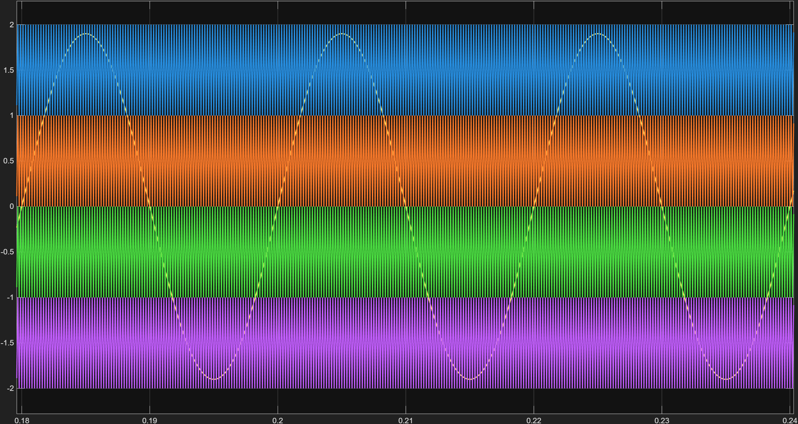
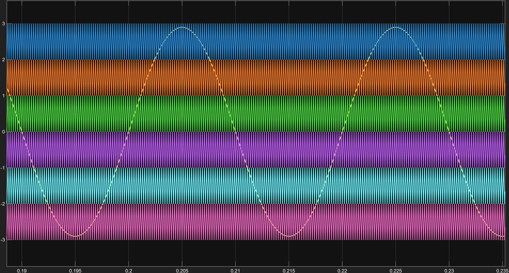

# Single-Phase Five-Level and Seven-Level Multilevel Inverter

## Project Overview

This project explores the modelling and simulation of two **single-phase multilevel inverter configurations** in MATLAB/Simulink:

- A five-level inverter
- A seven-level asymmetrical inverter

The models use carrier-based pulse-width modulation (PWM) to control the power switches. The output voltage waveforms and their harmonic content are examined through simulation, including FFT analysis using the `powergui` tool.

The aim was to understand how multilevel output waveforms are formed, how PWM controls the switching pattern, and how the harmonic performance changes between the two configurations.

## Software and Tools

- MATLAB
- Simulink
- Simscape Electrical / Specialized Power Systems
- `powergui` FFT Analysis

## Repository Contents

```text
Multilevel_Inverter_project/
├── Models/
│   ├── Five_Level_Inverter.slx
│   └── Seven_Level_Asymmetrical.slx
├── Results/
│   ├── Five_Level_Model.png
│   ├── Five_Level_Output_Voltage.png
│   ├── PWM_5_Level.png
│   ├── FFT_Analysis_5_Level.png
│   ├── Seven_Level_Model.png
│   ├── Seven_Level_Output_Voltage.png
│   ├── PWM_7_Level_Asymmetrical.png
│   └── FFT_Analysis_7_Level.png
└── README.md
```

## 1. Five-Level Single-Phase Inverter

The five-level Simulink model and its simulation results are shown below.

### Simulink Model


### Output Voltage


### PWM Signals



### FFT Analysis


The `powergui` FFT result reports a **50 Hz fundamental component** with a displayed fundamental magnitude of **191.1** and **30.44% THD**.

## 2. Seven-Level Asymmetrical Single-Phase Inverter

The second model is a seven-level **asymmetrical** inverter. Its Simulink model and simulation results are shown below.

### Simulink Model


### Output Voltage


### PWM Signals



### FFT Analysis


The `powergui` FFT result reports a **50 Hz fundamental component** with a displayed fundamental magnitude of **290.4** and **20.13% THD**.

## 3. PWM Technique

The models use **carrier-based, level-shifted PWM**. A low-frequency sinusoidal reference is compared with multiple high-frequency triangular carrier signals arranged in vertically displaced bands. The comparison signals are used to generate the switching pulses that produce the required output voltage levels.

In a level-shifted carrier arrangement, the number of carrier bands is related to the number of output voltage levels:

- Five-level output: four carrier bands.
- Seven-level output: six carrier bands.

The carrier arrangement visible in the provided PWM plots is consistent with a Phase Disposition (PD) style arrangement, in which the triangular carriers are in phase with one another and shifted vertically. The reference signal and carrier settings determine the switching instants and therefore affect the output waveform and harmonic spectrum.

## 4. Symmetrical vs. Asymmetrical Multilevel Inverters

The main distinction is the magnitude of the separate DC input sources.

| Feature | Symmetrical configuration | Asymmetrical configuration |
|---|---|---|
| DC source magnitudes | Sources have equal voltage magnitudes | Sources have unequal voltage magnitudes |
| Source arrangement | Identical DC input values | Different DC input values, often selected in a defined ratio |
| Level generation | Uses the combination of equal sources and switching states | Uses the combination of unequal sources and switching states |
| Design consideration | Simpler and more uniform source arrangement | Can produce more output levels with a suitable source ratio and switching arrangement |
| Practical trade-off | May require more sources/switching devices for a given number of levels | Source selection and voltage balancing/control can be more involved |

This repository includes a five-level model and a seven-level asymmetrical model. The table explains the general distinction; the exact DC-source values and ratios should be taken from the parameters in each Simulink model.

## 5. FFT and THD Results

FFT analysis is used to inspect the frequency components of the output voltage. Total Harmonic Distortion (THD) expresses the combined RMS contribution of the harmonic components relative to the fundamental component.

The values below are transcribed from the supplied `powergui` FFT screenshots.

| Inverter model | Fundamental frequency | Fundamental magnitude shown | THD shown |
|---|---:|---:|---:|
| Five-level | 50 Hz | 191.1 | 30.44% |
| Seven-level asymmetrical | 50 Hz | 290.4 | 20.13% |

In these displayed simulation results, the seven-level asymmetrical model has the lower THD: **20.13% compared with 30.44%** for the five-level model. This is a comparison of the supplied simulation results, not a claim that every seven-level inverter will always have lower THD. THD depends on the DC-source values, modulation index, carrier frequency, switching strategy, load, solver settings and the steady-state interval selected for FFT analysis.

## 6. How to Run the Models

1. Open MATLAB and make sure the required Simulink and electrical power-system libraries are installed.
2. Open the repository folder in MATLAB.
3. Open the relevant `.slx` file from the `Models` folder.
4. Check that the model parameters and required blocks are available in your MATLAB release.
5. Run the simulation and inspect the output voltage and PWM signals.
6. To repeat the harmonic analysis, open the model's `powergui` block and select **FFT Analysis**.
7. Select the output-voltage signal, set the fundamental frequency to 50 Hz, and analyse a steady-state portion of the simulation.

## Notes

- Both models are **single-phase**; they are not three-phase inverter models.
- The seven-level model is identified as asymmetrical in the model filename.
- The THD values in this README are the values visible in the supplied FFT screenshots. Re-run FFT analysis if the model parameters or simulation conditions are changed.
- The `.slx` files may require a compatible MATLAB release and the toolboxes used to build the models.

## Author

Electrical Engineering Student
