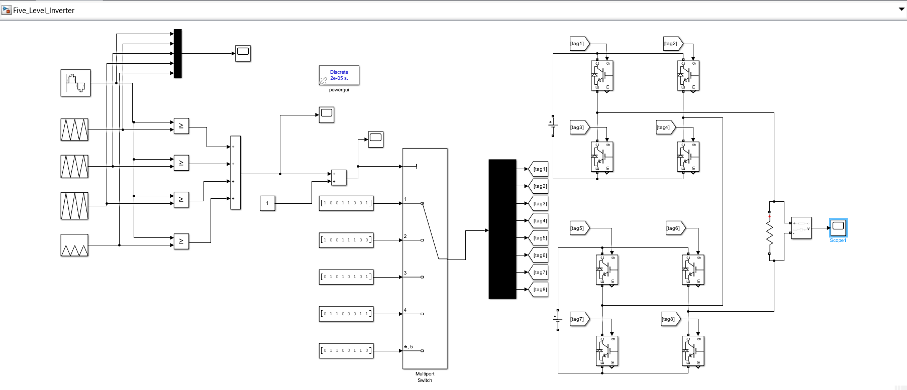
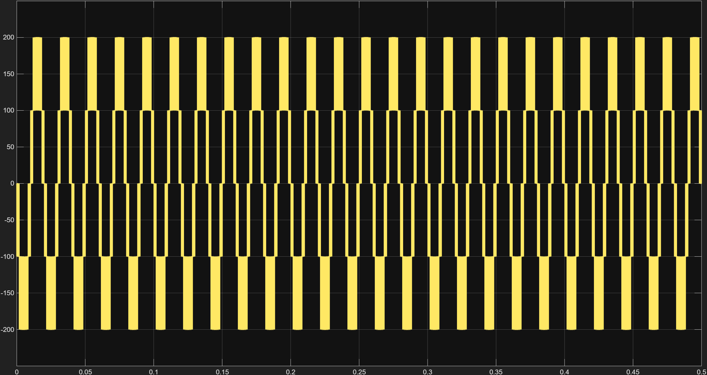
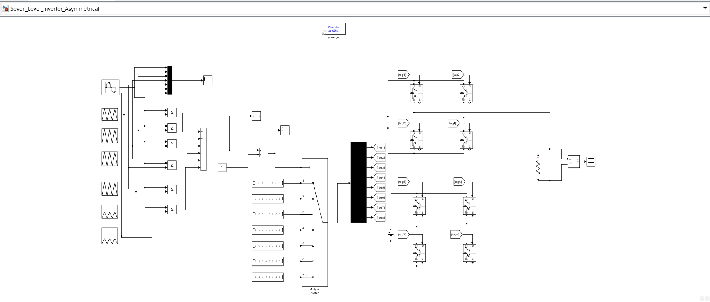
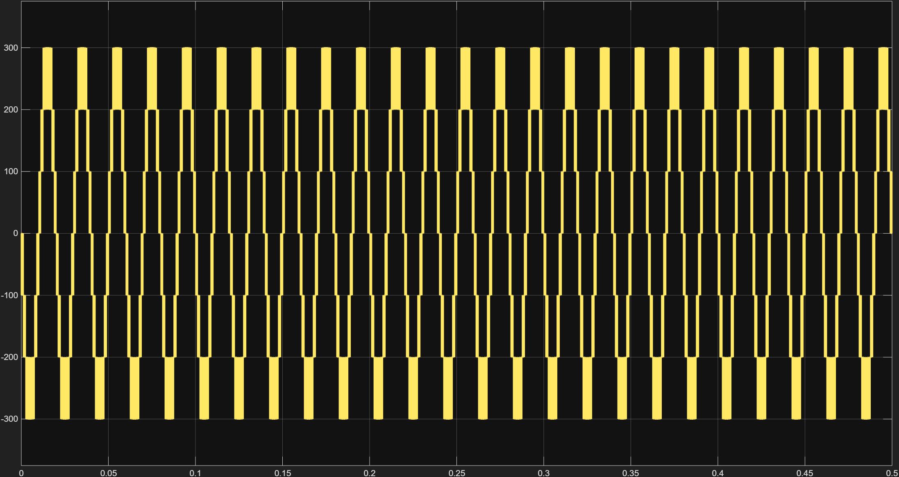
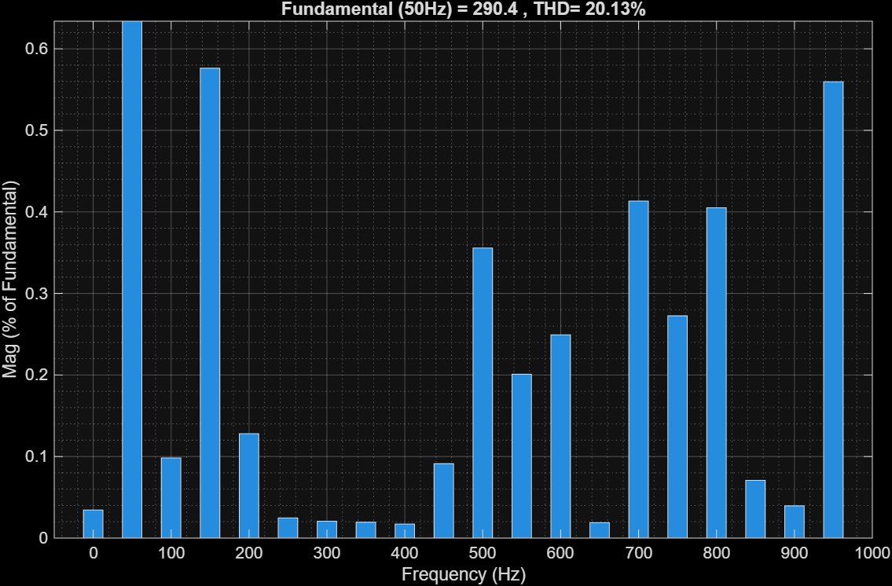

# Single-Phase Five-Level and Seven-Level Multilevel Inverter

## Overview

This project presents the modelling and simulation of **single-phase
five-level and seven-level multilevel inverters** using MATLAB/Simulink.
The models are used to observe inverter switching behaviour and output
waveforms, and to study the harmonic content of the output voltage using
FFT analysis.

The repository contains the Simulink models and the corresponding
simulation result images.

## Project Objectives

-   Develop and simulate a single-phase five-level inverter.
-   Develop and simulate a single-phase seven-level inverter.
-   Observe the PWM/switching signals and output voltage waveforms.
-   Perform FFT analysis of the output voltage.
-   Examine the harmonic spectrum and Total Harmonic Distortion (THD).

## Tools and Technologies

-   MATLAB
-   Simulink
-   Simscape Electrical / Specialized Power Systems (as applicable to
    the model)
-   `powergui` FFT Analysis

## Repository Structure

``` text
Multilevel_Inverter_project/
├── Models/
│   ├── Five_Level_Inverter.slx
│   └── Seven_Level_Asymmetrical.slx
├── Results/
│   ├── [Five-level output-voltage waveform]
│   ├── [Seven-level output-voltage waveform]
│   ├── [Five-level FFT result]
│   ├── [Seven-level FFT result]
│   └── [PWM/switching waveform images]
└── README.md
```

> The filenames shown in the Results folder above are descriptions, not
> exact filenames. Replace the placeholders with the actual image
> filenames in your repository.

## Inverter Models

### 1. Five-Level Single-Phase Inverter

The five-level Simulink model is provided in
`Models/Five_Level_Inverter.slx`.

**Model image:** Add a screenshot of the five-level Simulink circuit
here.

``` markdown

```

**Output waveform:** Add the output-voltage waveform image here.

``` markdown

```

**FFT result:** Add the FFT analysis screenshot here.

``` markdown

```

### 2. Seven-Level Single-Phase Inverter

The seven-level Simulink model is provided in
`Models/Seven_Level_inverter_Asymmetrical.slx`.

**Model image:** Add a screenshot of the seven-level Simulink circuit
here.

``` markdown

```

**Output waveform:** Add the output-voltage waveform image here.

``` markdown

```

**FFT result:** Add the FFT analysis screenshot here.

``` markdown

```

## FFT Analysis

FFT (Fast Fourier Transform) analysis is used to examine the frequency
components present in the inverter output voltage. The analysis can be
used to identify harmonic components and obtain the Total Harmonic
Distortion (THD).

For a 50 Hz fundamental output, the harmonic frequencies occur at
integer multiples of 50 Hz (for example, the 3rd harmonic is 150 Hz and
the 5th harmonic is 250 Hz).

**THD results:** Measured values from the powergui FFT
Analysis tool after running each model.

  -----------------------------------------------------------------------
  Inverter                Fundamental frequency                       THD
  configuration                                 
  ------------------- ------------------------- -------------------------
  Five-level,             50 Hz                                   30.44%
  single-phase  
  (Symmetrical)                                

  Seven-level,            50 Hz                                   20.13%
  single-phase 
  (Asymmetrical)                                 
  -----------------------------------------------------------------------


## How to Run the Models

1.  Install a compatible version of MATLAB and Simulink, with the
    required electrical power-system libraries.
2.  Clone or download this repository.
3.  Open MATLAB and set the repository folder as the current working
    folder.
4.  Open the required `.slx` file from the `Models` folder.
5.  Check that the model's required blocks and simulation settings are
    available.
6.  Run the simulation and inspect the output voltage and switching
    waveforms.
7.  Open the `powergui` block and use **FFT Analysis** to examine the
    output-voltage harmonics, if the model uses Specialized Power
    Systems.

## Notes

-   Both inverter configurations in this project are **single-phase**,
    not three-phase.
-   Simulation results depend on the switching strategy, circuit
    parameters, solver settings and simulation time.
-   The FFT analysis should be performed on a steady-state portion of
    the waveform.
-   The `.slx` models may require the MATLAB release and toolboxes used
    to create them.


------------------------------------------------------------------------


